<a href="https://shahrayar.vercel.app/en">
  
</a>

<h1 align="center">Shahrayar — Ordering Storefront</h1>

<p align="center">Char-grilled shawarma, wood-fired pizza and plates built to share — ordered in English, Arabic or Bulgarian.</p>

<p align="center">
  <a href="https://shahrayar.vercel.app/en"></a>
  <a href="https://moumen-alkamsheh.vercel.app/work/shahrayar"></a>
  <a href="https://github.com/mouminkam"></a>
</p>


## Overview

The customer-facing storefront for **Shahrayar**, a Middle Eastern restaurant: menu, per-dish customization, cart,
coupons, delivery quotes, checkout, order history and a full auth flow, in **three languages** with right-to-left
Arabic rendered on the server. It is built the way the real thing would be, then had its network cord cut on purpose.

There is no backend, no database and no API key in this build. Every function that would call an endpoint resolves
against local fixtures through *the same seam* a real call would use (see Architecture).
[shahrayar.vercel.app](https://shahrayar.vercel.app/en) is this repository, deployed as-is.

## Highlights

- **The whole ordering flow** — customize a dish (size, ingredients, option groups, sauces), add to cart, apply a
  coupon, get a delivery quote, check out and see the order in your history.
- **Trilingual with real RTL** — English, Arabic and Bulgarian (~370–385 keys each) on `/{locale}/…` routes, with
  detection from cookie → `Accept-Language` → default. Arabic is `dir="rtl"` from the first server-rendered byte.
- **Full auth flow** — register, sign in, phone OTP, Google OAuth, forgot and reset password, against the mock layer.
- **A checkout that works** — a Leaflet delivery map with reverse geocoding, a live delivery-fee quote, and Cash on
  Delivery as a completable path (Stripe is wired on the UI and stubbed).
- **Server-rendered SEO** — `generateMetadata` per route, a locale-aware `sitemap.xml` and `robots.txt`, Open Graph
  tags, and legal pages that also open in a modal from the same content.
- **One visual identity** — `#EB0029` and `#FFBA00`, consistent across the site.

## Architecture

```text
src/
├── app/[lang]/     App Router routes. [lang]/layout.tsx is the one root layout and renders <html lang dir>,
│                   so locale and direction are right in the first byte.
├── api/            One module per backend resource (auth, menu, orders, payments…), typed against ApiResponse<T>.
├── mocks/          fixtures/ plus mockClient.ts — the envelope every api/* call resolves through.
├── content/        Static content (menu, branches, chefs, legal copy) as TypeScript modules.
├── components/     ui/, layout/, cart/, auth/, pages/<route>/, seo/
├── hooks/          Data and UI hooks: cart helpers, localized routing, API caching.
├── store/          Zustand stores: cart, auth, branch, toast.
├── lib/            Utilities, Zod schemas, i18n helpers.
└── locales/        en.json, ar.json, bg.json and the i18n config.
proxy.ts            Locale detection and auth route protection (Next.js 16's middleware convention).
```

**Data flow:** components → hooks → `api/*` → `mocks/mockClient.ts` → `mocks/fixtures/*`. In every `api/*` module the
mock body sits directly under a commented `PRODUCTION:` line — the exact `axiosInstance` call it replaces:

```ts
export const getMenuItems = async (params: Record<string, unknown> = {}): Promise<MenuItemsApiResponse> => {
  // PRODUCTION: return axiosInstance.get<MenuItemsApiResponse>("/menu-items", { params });
  const items = /* …filter mockMenuItems by params… */;
  return mockResponse({ items });
};
```

To connect a backend, set `NEXT_PUBLIC_API_BASE_URL` (see `.env.example`) and swap each mock body for the line above
it. Hooks, stores and components already consume the same `ApiResponse<T>` contract.

| Route | What it is |
| --- | --- |
| `/{locale}` | Home: hero, popular and latest dishes, chef's special, chefs |
| `/{locale}/shop`, `/shop/[id]` | Menu · dish detail |
| `/{locale}/cart`, `/checkout`, `/checkout/stripe/*` | Cart · delivery map and payment · Stripe pay, success, failed, cancel |
| `/{locale}/orders`, `/orders/[id]` | Order history · detail and confirmation |
| `/{locale}/login`, `/register`, `/add-phone`, `/enter-otp`… | Email/password, Google OAuth, phone-OTP registration |
| `/{locale}/about-us`, `/contact-us`, `/terms-conditions`, `/privacy-policy` | Content and legal pages, all three locales |

## Getting started

```bash
npm install
npm run dev        # http://localhost:3000 → redirects to /en (or open /ar, /bg)
```

Any email and password signs in, OTP screens accept any 4-digit code, and Cash on Delivery completes an order.

## Scripts

| Command | What it does |
| --- | --- |
| `npm run dev` | Development server |
| `npm run build` · `npm start` | Production build · serve it |
| `npm run lint` | ESLint (house config) |
| `npm run typecheck` | `tsc --noEmit` over the application code |
| `npm test` | Jest (`test:watch`, `test:coverage` too) |

CI runs lint, typecheck and the build on every push and pull request.

## Engineering notes

### A kitchen doesn't plate a photo of the dish. This one nearly did.

A scan of `public/img` for one specific gray (`rgb(184,184,184)`) found **81 `"580X550"` placeholder stubs** left from
the original template. Cross-referencing them against `src/` showed **9 still wired into live data**: five dishes and
three desserts a customer could order, and the demo account's own avatar. Nothing crashed — the page rendered, the
layout held — which is exactly why it was easy to miss. Each one now has real photography; the other ~65 were
confirmed dead and left alone. Sources are in [`docs/PHOTO_CREDITS.md`](docs/PHOTO_CREDITS.md).

### The delivery map doesn't call a public API

Reverse geocoding usually means Nominatim: free, but rate-limited to one request per second — a bad dependency for a
page anyone can click through. `src/mocks/fixtures/geocode.ts` snaps the pin to the nearest of a handful of real
Sofia districts and returns an address in Nominatim's exact shape, so validation, autofill and the delivery quote
are unchanged. No external call, nothing that can go down.

## Honest trade-offs

- **The test suite needs a rewrite.** Jest is now configured and runs (81 of 96 tests pass), but 15 tests were
  written for the axios layer before the switch to fixtures, and three suites import a shared `mockData` module that
  no longer exists. Until they are rewritten, tests stay out of CI and out of the app typecheck.
- **Card payments don't charge anything.** Stripe stops at a labeled stub; Cash on Delivery is the completable path.
- **The mock catalog is English-first.** Site chrome is translated in all three locales; dish copy would come per
  locale from a real backend through `getLocalizedField()`.
- **No persistence** beyond memory and `localStorage`, on purpose.
- ESLint reports **no errors and 130 warnings**, mostly typing debt: 50 `no-explicit-any`, 43 unused variables, 21
  `set-state-in-effect`.

<a href="https://github.com/mouminkam">
  
</a>
